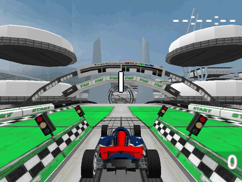
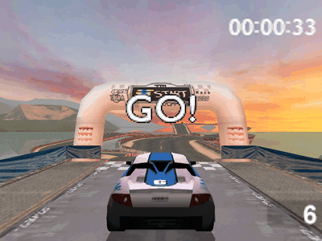
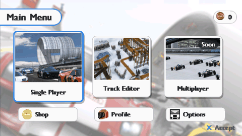
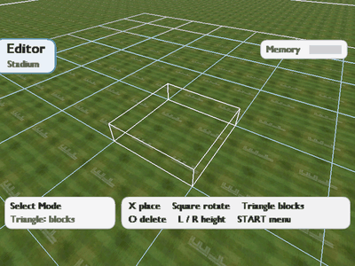

# TM2PSP

Native PSP port of **TrackMania Turbo (DS, Europe, `BT2P`)** through decompilation: the DS game's own code, rebuilt
for the PSP, with its tracks, cars, physics, sound, menus and track editor.

| Race (Stadium) | The four environments |
|---|---|
|  |  |
| **Menus** | **Track editor (free draw)** |
|  |  |

**No game data lives in this repository**: no ROM, no models, sounds, textures, scripts or pictures of the game.
The builder takes them from your own dump of the cartridge and produces the PSP game folder.

## What you need

- **Your own dump of TrackMania Turbo DS, Europe** (game code `BT2P`, "En, Fr, De, Es, It"), made from a cartridge
  you own, for example with GodMode9i on a DSi or 3DS. The supported dump has SHA-1
  `857b8f5f5ce9b91eaa04e35b99a591243672e51c`; a trimmed dump of it works too. Other regions are not supported.
- **A PSP with custom firmware** (for example 6.61 LME, PRO or ARK) and 64 MB of memory: PSP-2000, 3000 or Go. The
  PSP-1000 (32 MB) is not expected to work. The game also runs in the [PPSSPP](https://www.ppsspp.org) emulator.
- **Python 3.11 or later** with Pillow.
- **A PSP toolchain** to compile the EBOOT: pspdev on Linux, macOS or Windows (through WSL), or Docker. Or no
  toolchain at all, with the EBOOT compiled by this repository's CI (see below).

## Installing the tools

### Python

Install Python 3.11+ ([python.org](https://www.python.org/downloads/) on Windows: tick "Add python.exe to PATH"),
then Pillow:

```bash
python -m pip install pillow
```

### The PSP toolchain: pick one

**Linux (Ubuntu 24.04 or later, or any distribution with glibc 2.38+).** Install CMake and make, then download
the latest [pspdev release](https://github.com/pspdev/pspdev/releases/latest) for your system
(`pspdev-ubuntu-latest-x86_64.tar.gz` on Ubuntu; Debian and Fedora archives are there too):

```bash
sudo apt install cmake make
```

```bash
tar -xzf pspdev-ubuntu-latest-x86_64.tar.gz -C ~
```

Then add these two lines to `~/.bashrc` and open a new terminal:

```bash
export PSPDEV=~/pspdev
export PATH="$PATH:$PSPDEV/bin"
```

`psp-cmake --version` should now answer.

**macOS.** Take the macOS archive of the same release (`arm64` for Apple silicon, `intel` otherwise) and follow
[pspdev's installation guide](https://pspdev.github.io/installation.html), with the same two `export` lines.

**Windows.** Install WSL with Ubuntu 24.04 from PowerShell, then follow the Linux steps inside it. The builder,
run from Windows, finds the WSL distribution that has `psp-cmake` by itself.

```powershell
wsl --install -d Ubuntu-24.04
```

**Docker (any system).** Install Docker (Docker Desktop on Windows and macOS). The builder compiles in the
`pspdev/pspdev` image, downloaded the first time.

**No toolchain.** Every push is compiled by GitHub Actions: open the repository's **Actions** tab, the latest
successful **build** run, and download the **EBOOT** artifact (a zip holding `EBOOT.PBP`; a GitHub account is
needed). Pass it to the builder with `--eboot`.

## Building the game

Get the sources (or download them as a zip from GitHub):

```bash
git clone https://github.com/26000-star/TM2PSP.git
```

From the `TM2PSP` folder, give the builder your ROM:

```bash
python -P builder.py --rom "TrackMania Turbo (Europe) (En,Fr,De,Es,It).nds"
```

With the EBOOT downloaded from the CI instead of a toolchain:

```bash
python -P builder.py --rom "TrackMania Turbo (Europe) (En,Fr,De,Es,It).nds" --eboot EBOOT.PBP
```

The builder reads the game's files from the ROM and checks them, converts the menu pictures, compiles the EBOOT
and writes the memory stick folder `build/psp/package/PSP/GAME/TM2PSP` (about 30 MB). Options:

| Option | Effect |
|---|---|
| `--out <dir>` | where to write the `PSP` folder (default `build/psp/package`) |
| `--eboot <file>` | use this EBOOT.PBP instead of compiling one |
| `--toolchain native\|wsl\|docker` | force a toolchain (default: `psp-cmake` on the PATH, then WSL, then Docker) |
| `--wsl-distro <name>` | the WSL distribution to compile in |
| `--force` | accept a ROM whose files differ from the supported dump (untested, may not work) |

## Installing on the PSP

Copy the `PSP` folder from `build/psp/package` to the root of the memory stick, merging it with the one already
there: the game lands in `ms0:/PSP/GAME/TM2PSP/`. Launch **TM2PSP** from the XMB (Game → Memory Stick).

Rebuilding later and copying again keeps your progress: `save.txt`, your ghosts and your tracks (`tracks/`) are
written next to the EBOOT and the builder never overwrites them.

In PPSSPP, open `PSP/GAME/TM2PSP/EBOOT.PBP` from the package folder.

## Controls

| | Menus | Race | Track editor |
|---|---|---|---|
| Cross | choose | accelerate | place a block (hold in free draw) |
| Circle | back | | delete |
| Square | | brake, reverse | rotate the block |
| Triangle | | back to the last checkpoint | block menu |
| D-pad | move | steer | move the cursor |
| Stick | | steer | turn and zoom the camera |
| L / R | | horn / frame times overlay | lower / raise |
| START | | pause menu | editor menu (free draw, test, validate, save...) |
| SELECT | | change camera | help |

The menus follow the console's language (English, French, German, Spanish, Italian). An empty file `mute.txt`
next to the EBOOT turns the sound off.

## What is in the game

Race mode (the 104 tracks of Stadium, Island, Snow and Coast, with medal ghosts and your best runs), platform and
puzzle modes, the track editor (blocks, free draw, test drive, validation, save and load, My Tracks), the shop,
the profile and the options. Not ported: multiplayer (local wireless and online) and the intro movie.

## Your own menu pictures

The main menu's background, its three cards and the shop, profile and options icons come from the ROM's DS menus.
To use other pictures, put PNG files named `background`, `solo`, `track`, `multi`, `shop`, `profile` and
`options` (any size) in `assets/fe/` before running the builder. That folder is ignored by git.

## Troubleshooting

- **`error: game code ..., expected BT2P`**: this is not the European TrackMania Turbo; only that version is
  supported.
- **`error: vfs.zip differs from the supported dump`**: a bad or modified dump. Dump the cartridge again.
- **`error: no PSP toolchain`**: install one of the toolchains above, or use `--eboot` with the CI's EBOOT.
- **`python: command not found` / `-P` rejected**: Python is missing or older than 3.11 (`python --version`); on
  Windows, try `py -3` instead of `python`.
- **The game is missing from the XMB**: the folder must be `ms0:/PSP/GAME/TM2PSP/EBOOT.PBP`, and the PSP must run
  custom firmware.

## For developers

How the port was made (reverse engineering, code map, host and PSP back-ends, checks): see
[docs/DEVELOPMENT.md](docs/DEVELOPMENT.md), the detailed log [docs/PORT.md](docs/PORT.md) and the feasibility study
[STUDY.md](STUDY.md). Before contributing, `git config core.hooksPath .githooks` enables the pre-push hook, which
refuses a push that would publish a game file.
